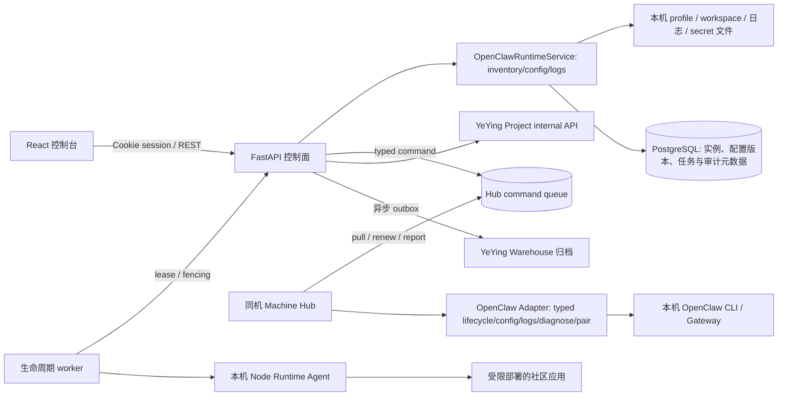

# Orchestrator 控制面技术设计

更新时间：2026-10-31
适用范围：当前仓库的控制台、API、运行时管理与节点应用部署能力。

本文刻意区分“已实现”与“目标架构”。产品边界、竞品类别和市场参考见[产品定位与领域架构](product-architecture.md)；本文件以代码现状为准，不把规划能力写成已交付能力。

## 1. 产品边界

Orchestrator 是管理 Agent Runtime 与其工作负载的控制面。它不负责 Agent 推理，不是 MCP Server，也不是通用工作流引擎。

```text
Web Workbench -> Backend / Control Plane   # 当前 API；目标上是中心控制面
                    ├── Organizations / Projects / Policies  # 目标模型；RBAC 尚未实现
                    └── Machine Registry
                         └── Machine Hub                      # 协议客户端与 OpenClaw create/lifecycle Adapter 已有首期实现
                              └── Runtime Adapter             # Runtime API 与旧 Messenger 实例操作均经 Hub
                                   └── Runtime Instance       # 独立配置、profile、工作目录和端口
                                        └── Workload          # Agent、消息工作台或社区应用
                                             └── Tool / MCP Server
```

关键边界：

- Machine Hub 是运行在每台机器上的受控服务，主动连接 Backend；它是目标执行边界，不等同于当前已实现的 Runtime Node 心跳接收 API。
- Runtime Node 是当前登记机器的数据库对象；目标上由 Hub 身份及心跳驱动。Hub 本机 OpenClaw 状态现为 JSON/Secret Store；Backend 仅保留 owner、期望/观测状态与 inventory 镜像目录。
- Runtime Adapter 是 Hub 内对 Codex CLI、Claude Code CLI、OpenClaw 等 Runtime 的类型化适配；不同 Runtime 的能力按需声明，不假设具有同一套完整操作。
- Runtime Instance 是某个 Hub 机器上的运行时实例；当前实例只落在控制服务所在主机。
- Workload 是运行在 Runtime 或受管应用环境中的业务负载。消息和交易属于工作台，不是 Runtime 类型。
- MCP Server 是 Agent 可调用的工具服务；登记其连接信息不等于 Orchestrator 已管理其进程。
- Lifecycle Task 是已实现的社区应用安装、升级、卸载任务；Runtime API 与旧 `/agent` 的 OpenClaw 创建、删除、模型配置、启停、日志、配对和诊断现为 Hub 命令，不应和异步部署任务混称。

## 2. 当前架构



上图是当前控制面闭环：Runtime API 与旧 Messenger `/agent` 路由经 Backend 命令队列由 OpenClaw Adapter 执行，Backend 只保留授权、目录和结果镜像。Node 心跳路由与 Machine Hub 是两套不同接口。目标拓扑继续扩展为每台远程机器一个 Hub：

```text
Web -> Backend / Control Plane <- HTTPS pull + reports - Hub A -> 本机 Runtime Adapters -> Instances
                                <- HTTPS pull + reports - Hub B -> 本机 Runtime Adapters -> Instances
```

Web 不直连 Hub。首期协议使用短轮询/长轮询；命令具备幂等 ID、期望修订号、fencing attempt 和过期时间。离线重连先补报结果/事件并刷新 inventory，不执行已过期命令。具体约束见[Hub 架构 ADR](hub-architecture-adr.md)。

### 2.1 前端

- `web/` 是 React + TypeScript + Vite SPA，控制台与消息、交易工作台共用登录会话和导航壳。
- 控制面页面是运行概览、Runtime Provider 状态和 Runtime Instance 列表；钱包登录页按需加载钱包 SDK。
- 页面查询与变更由 TanStack Query 封装；API 请求通过同源 `/api` 访问，开发环境由 Vite 代理至后端。
- 当前 UI 可操作本机 OpenClaw 实例。尚无节点注册/连接状态界面、跨节点调度和通用 Runtime 表单；心跳清单仅提供给持有运维 token 的 internal API 调用方。

### 2.2 后端

- `backend/src/orchestrator/api/` 提供 FastAPI public 与 internal 路由。
- `services/openclaw.py` 仍管理本机 OpenClaw profile、进程、配置、配对、日志和诊断；工作台 start/stop 已不再直接调用其进程操作。
- `services/nodes.py` 接收 Runtime Node 心跳并按服务端超时计算在线状态；Machine Hub 协议客户端、OpenClaw 启停 Adapter 和模拟 Adapter 已有首期实现，但 Hub 仍需手动运行，尚无生产服务安装和远程主机验证。
- `services/runtime_providers.py` 从最近在线的 Machine Hub heartbeat 返回 OpenClaw Adapter 能力；尚无多 Hub 目录页或可插拔的异构适配器管理界面。
- `adapters/` 目前主要是 Messenger、Trader 等工作台适配器，不应误认为 OpenClaw/Nanobot/Hermes Runtime Provider 已经实现。
- `lifecycle_worker.py` 消费 Node 应用生命周期任务；与 Orchestrator Web/API 服务分进程运行。当前 worker、Node Runtime Agent 与受管应用都在同一主机，不使用 Docker 启动 Orchestrator 本身。

## 3. 领域状态与操作

实例至少有两类状态：

- `desired_state`：操作者要求的目标状态，例如 `running` 或 `stopped`。
- `observed_state`：本机进程管理器观察到的状态，例如 `starting`、`running`、`stopped`、`error` 或 `unknown`。

两者不能合并：用户发起启动并不意味着实例已健康运行。工作台 start/stop 命令由 Hub Adapter 执行并回报结果，实例列表仍从原有 OpenClaw 存储读取；Hub inventory 尚未成为列表状态的唯一权威来源，远程实例状态上报和持续 reconcile 尚未完成。页面中的“运行中”表示进程观测，不代表端到端 Agent 业务健康。

当前控制台流程：

1. 钱包签名登录，后端建立 HttpOnly Cookie session。
2. 页面读取当前钱包拥有的实例，以及本机可执行的 Runtime Provider。
3. 用户通过消息工作台创建 OpenClaw 实例；服务分配实例 ID、端口、独立 profile 与工作目录，并把实例元数据存入配置的状态后端。
4. 用户启动/停止实例；Backend 按钱包 owner 校验后签发 Hub command，Hub Adapter 执行并回报终态；Hub 离线时不回退到 Backend 本机直接操作。
5. 页面刷新观测状态、诊断结果与日志。连接渠道、模型调用和 Agent 回复仍由 OpenClaw 与相应上游负责。

生产应用部署流程是另一条异步链路：Project 提交幂等生命周期任务，PostgreSQL 保存任务和事件；专用 worker 以带租约和 fencing 的方式领取任务，校验发布制品和签名后交给本机 Node Runtime Agent 执行，并报告结果。当前不是远程 Runtime Node 部署。Worker 默认关闭，启用前置条件见[生产运维文档](operations.md)和[Agent Runtime Protocol](agent-runtime-design.md)。

## 4. 持久化边界

| 数据 | 权威存储 | 说明 |
|---|---|---|
| Runtime Instance、节点元数据、配置版本 | 配置 PostgreSQL 时使用 PostgreSQL；未配置时退回本机 JSON | JSON 模式只适合单进程开发或实验，不支持多副本一致性 |
| Project 安装状态、生命周期任务与事件、审计和 outbox 元数据 | PostgreSQL | 通过 Alembic 版本化迁移；任务有幂等、租约、attempt fencing 与退避重试 |
| OpenClaw profile、workspace、运行日志、配对文件 | 本机运行目录及仓库外的 profile 目录 | 与控制面数据库分开备份；日志正文和可重建进程状态不写入关系库 |
| 渠道密钥与应用环境凭证 | 当前为节点本地权限受限文件，数据库仅保存引用 | 尚未接入外部 Secret Manager/KMS；仍需密钥轮换设计 |
| 事件归档 | Warehouse 异步 outbox | Warehouse 是归档目标，不是运行状态权威来源 |
| Agent 长文本/检索向量 | 不在当前控制面 | 向量数据库不应替代实例、任务等事务状态库 |

本地和生产都从 `backend/.env` 读取参数。`HUB_*` 是现存环境变量契约，未随 Python 包名和目录改名一起修改；修改这些键需要单独的配置迁移，不要只改模板而不处理代码、脚本和部署环境。数据库、迁移、运行目录和备份要求见[运行时数据规划](runtime-data.md)。

## 5. API 边界

### Public 控制台 API

- `GET /api/v1/public/runtime/providers`：列出当前本机已实现的 Runtime Provider 与可检测能力；目前只返回 OpenClaw。
- `GET /api/v1/public/runtime/instances`：列出当前钱包拥有的实例与期望/观测状态。
- `POST /api/v1/public/runtime/instances`：创建 OpenClaw 实例；其他 `runtime_type` 明确拒绝。
- `POST /api/v1/public/runtime/instances/{id}/actions/{start|stop}`：操作本机实例。
- `GET /api/v1/public/runtime/instances/{id}/logs`、`GET .../diagnose`：读取本机运行证据。
- `/api/v1/public/agent/instances/*`：既有消息工作台仍使用的实例配置、配对和兼容接口。

### Internal 与 Worker API

Project 生命周期兼容路由、Node worker claim/heartbeat/release/result、独立 token、发布校验和执行限制见[Agent Runtime Protocol](agent-runtime-design.md)。浏览器 API 不提供任意 shell 或远程主机执行入口。生产运维目前依赖受控主机访问和 worker 配置，没有完整的多租户 Admin API。

### Machine Hub Protocol API

首期 Hub 服务端路由使用独立于 Runtime Node 的数据库凭证。管理员凭证接口和受控命令签发暂由 `HUB_ADMIN_TOKEN` 保护；Hub 自身 API 使用每 Hub 独立 Bearer token：

| 方法 | 路径 | 用途 |
|---|---|---|
| POST | `/api/v1/internal/hubs/{hub_id}/credentials` | 管理员签发 Hub credential，secret 只返回一次 |
| GET | `/api/v1/internal/hubs/{hub_id}/credentials` | 管理员查询凭证状态/有效期，不返回 secret |
| POST | `/api/v1/internal/hubs/{hub_id}/credentials/{credential_id}/revoke` | 管理员撤销 credential |
| POST | `/api/v1/internal/hubs/{hub_id}/heartbeat` | Hub 上报版本、机器元数据和 Adapter 能力 |
| PUT | `/api/v1/internal/hubs/{hub_id}/inventory` | Hub 上报完整 Runtime Instance 清单 |
| GET | `/api/v1/internal/hubs/{hub_id}/commands` | Hub 拉取命令，claim 时创建 60 秒 lease 和递增 attempt；过期 lease 可以由新 attempt 回收 |
| POST | `/api/v1/internal/hubs/{hub_id}/commands/{command_id}/lease` | 当前 attempt 续租；租约已经失效或 attempt 不匹配时拒绝续租 |
| POST | `/api/v1/internal/hubs/{hub_id}/events` | Hub 批量补报连续序号事件，服务端去重并确认 cursor |
| POST | `/api/v1/internal/hubs/{hub_id}/commands` | 管理员签发类型化命令；除创建命令外，要求目标 Instance 在最新 inventory 且 capability 已声明 |

credential digest、Hub inventory、command lease/attempt、命令结果和事件写入迁移 `0007_machine_hub_protocol`；`0008_hub_runtime_create` 增加类型化创建 payload 和允许未分配端口的目录占位。`create_instance` 是受限的 OpenClaw 创建类型，创建负载不接受任意对象或 shell 字段；DingTalk secret 以目标 Hub 专属 Fernet 密文持久化。命令签发按 `(hub_id, idempotency_key)` 幂等；同一实例同一时刻最多领取一条有效命令。状态操作的 `desired_revision` 必须按实例递增，更高 revision 会 supersede 尚未完成的旧状态命令；`inspect_instance` 不推进 revision。Hub 客户端按单条领取，长操作期间通过显式 lease API 续租；租约失效后的迟到事件仍可记录，但不能改变命令结果，过期命令也不会因迟到事件恢复为成功。失去租约时，客户端请求 Adapter 协作取消并等待本机操作停止，之后把结果记为 `unknown`。该 API 与模拟 Hub 客户端闭环已验证，但不等于生产 Hub 部署、用户级授权或真实 Runtime 执行。

Runtime Node 运维接口：

| 方法 | 路径 | 用途与鉴权 |
| --- | --- | --- |
| POST | `/api/v1/internal/runtime-nodes/{node_id}/heartbeat` | Node 上报 Agent 版本、Provider 能力、资源和标签；使用按节点配置的 Bearer token |
| GET | `/api/v1/internal/runtime-nodes` | 查询全局节点清单；仅接受显式配置的 `HUB_ADMIN_TOKEN`，不接受 Project 的 `HUB_INTERNAL_TOKEN` |

节点心跳凭证通过 `HUB_RUNTIME_NODE_TOKENS` 环境配置，数据库不保存 token；默认离线阈值为 `HUB_RUNTIME_NODE_OFFLINE_AFTER_SECONDS=90`。清单 API 是运维接口，当前没有前端页面或租户级授权。非本机通信需使用 HTTPS 和受控网络。

以上 Runtime Node API 是现存的旧心跳/运维接口，不是 Hub Protocol v1。新的 `/hubs/*` 服务端 API 已有独立 DB credential、inventory、命令和事件表；本地客户端支持 SQLite inbox/outbox，OpenClaw 启停也已由 Adapter 执行，但尚无远程多机生产验收或工作台 Hub 管理视图。

## 6. 身份与安全边界

- Public 控制台由钱包签名换取 HttpOnly Cookie session；实例以钱包 owner 做查询隔离。
- Project `HUB_INTERNAL_TOKEN`、Node worker `HUB_WORKER_TOKEN`、运维 `HUB_ADMIN_TOKEN` 和每个 Runtime Node 的心跳凭证彼此分离；worker 请求通过 worker ID 和 attempt generation 做 fencing。
- Machine Hub credential 是数据库内单独签发/撤销的随机 token，DB 仅保存 SHA-256 摘要，与 `HUB_RUNTIME_NODE_TOKENS` 和 Project/worker token 不共用；管理员 credential API 暂由全局 `HUB_ADMIN_TOKEN` 控制，尚无多租户授权。
- Router key 和服务端密钥不下发到浏览器；生命周期请求不能直接携带任意应用密钥。
- 目前没有组织/项目 RBAC 管理台、细粒度权限审批、完善的 session 吊销列表或统一审计查询 UI。
- UCAN 数据当前只透传，不代表服务端已完成 UCAN 验签。
- OpenClaw profile 具有连接渠道所需的本机凭证，应按敏感数据对待并纳入节点备份、访问控制和销毁流程。

## 7. 运行、测试与升级

本地前后端启动命令以仓库根目录 [README](../README.md) 为准。数据库 schema 通过 Alembic 管理，部署升级前先备份并执行 `cd backend && uv run alembic upgrade head`。生产服务脚本、独立 worker、健康检查与回滚步骤见[生产部署与运维](operations.md)。

当前测试重点覆盖钱包鉴权/实例隔离、PostgreSQL 存储语义（使用 SQLite 测试后端）、任务租约和重试、发布签名/部署限制，以及 Messenger/Trader 适配器。单元测试通过不等于远程 Node、多主机调度或生产环境已经验收。

## 8. 现状差距与演进顺序

### 已实现

1. OpenClaw 本机进程的独立 profile、创建、启停、WhatsApp 配对、日志与诊断。
2. 实例期望状态/观测状态、PostgreSQL 控制数据、配置版本和 owner 隔离。
3. 受签名校验、受限执行、健康探测、回滚保护的单节点社区应用生命周期 worker。
4. Runtime Node 心跳接收、Provider/资源/标签持久化和超时在线判定；另有 Machine Hub 协议客户端和 OpenClaw typed Adapter，Runtime API 与旧 Messenger 实例操作经 Hub command 完成真实 Backend HTTP 闭环。
5. 运行概览和实例列表前端；钱包 SDK 延迟加载；页面具备 loading、空、错误、刷新和窄屏表格状态。

### 尚未实现或尚未生产验收

1. 可部署/守护的 Hub 服务进程、本机 inbox/outbox 运维、凭证轮换、Hub 安装/升级、版本兼容和远程机器离线恢复流程；OpenClaw 命令已迁入 Hub，但 profile/config 仍需更细的 typed operations 和前端状态呈现。
2. 可插拔 Runtime Adapter contract 及 Nanobot、Hermes 等 Runtime 的实际操作实现。
3. 跨节点任务调度、运行时状态 reconcile、多节点容量/配额和实例迁移。
4. 组织/RBAC、管理员审计浏览器、告警、指标、备份恢复演练及部署规模测试。
5. 应用端口池、租户公网路由和 Secret Manager/KMS。

### 建议的产品和技术顺序

1. Hub v1 核心消息、JSON Schema、数据库表、服务端 API 和 SQLite 客户端已完成首期；续租、失租处理和协作取消已有测试。
2. OpenClaw typed Adapter 和 Runtime/Messenger API 委派已接入；下一步让前端以 Hub inventory/观测事件作为实例状态权威来源，并补齐操作状态。
3. 补 Hub 进程锁、凭证轮换、服务安装/升级、版本兼容、硬取消与故障恢复演练，再扩展远程机器。
4. 再逐个验证 Codex CLI、Claude Code CLI 等 Runtime Adapter；某能力不支持时显式返回 unsupported，不用通用 shell 执行伪装兼容。
5. 在多用户/多节点公开运营前完成 RBAC、审计、告警、备份恢复、凭证治理与故障演练。

市场产品参考与产品定位见[产品定位与领域架构](product-architecture.md)。Dify、LangSmith 偏 Agent 应用构建/观测，Portainer 偏基础设施管理，Temporal 偏持久任务执行；Orchestrator 应借鉴各自相关能力，而不是混淆产品职责。
